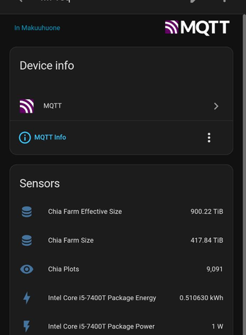
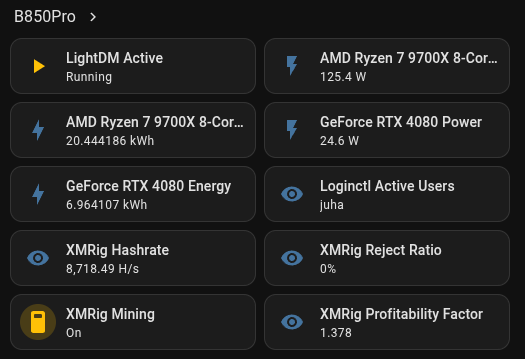

# mqtt-sensors

Long-lived root processes that publish host stats to MQTT with Home Assistant discovery. One process per collector; each holds one source open or polls one in-process. No framework, no `requirements.txt`, no pip.

- [SECURITY.md](SECURITY.md): supply-chain / root policy.
- [CODE_OF_CONDUCT.md](CODE_OF_CONDUCT.md): fail-fast and minimalism.
- [AGENT.md](AGENT.md): contract for coding agents adding a sensor (an `AGENTS.md`).
- [windows/](windows/README.md): Windows power and XMRig collectors plus a tray launcher.

Collectors on a host share one HA device `linux_host_<hostname>`, named after the host. Device-scoped power-supply batteries get their own HA device linked with `via_device`.





## Collectors

| collector | what HA shows | source (held open) |
|---|---|---|
| `cpu_package_power.py` | package power (W), energy (kWh) | RAPL `energy_uj` fd |
| `nvidia_gpu_power.py` | per-GPU power (W), energy (kWh) | one `nvidia-smi --loop=1` |
| `chia_farm_size.py` | plots, on-disk TiB, effective TiB, netspace EiB, ETA to win (s) | farmer `:8559` + full node `:8555` TLS |
| `chia_recompute_server_processing_time.py` | recompute processing time (s) | `journalctl -u chia_recompute_server -f` |
| `chia_harvester_processing_time.py` | harvester processing time (s), plot count | uid 1000 `debug.log` fd, reopened on daily rotate |
| `loginctl_active_users.py` | comma-separated users with `active`/`online` sessions | `/run/systemd/users` |
| `lightdm_active.py` | switch: LightDM running | `lightdm.service` cgroup dir |
| `ollama_active.py` | switch: Ollama running | `ollama.service` cgroup dir |
| `hwmon_drive_temperature.py` | per-drive temperature (°C) | `/sys/class/hwmon` + SAT `SG_IO`, every 60 s |
| `power_supply_battery.py` | per-battery capacity (%) | `/sys/class/power_supply`, each second |
| `xmrig_status.py` | hashrate (H/s, 60 s), reject ratio (%), mining switch, intensity slider (0–100%), profitability factor | XMRig HTTP + MQTT inputs |
| `support/xmr_eur_price.py` | XMR/EUR (EUR) | Kraken public ticker, 60 s |
| `support/xmr_network.py` | Monero difficulty, network hashrate (H/s), block reward (XMR), XMR/H/s/day | xmrchain.net, 60 s |

Run only the collectors that apply. Energy is `total_increasing` kWh integrated in RAM and resets on start; HA expects that. Processing times publish full precision with 1 decimal displayed; do not average.

- **Chia:** paths are uid 1000's `.chia/mainnet` (`chia_root()`), never `/root` or a username. ETA is `(netspace / effective) * 18.75`. Recompute work arrives in 10 s bursts; 0.2–5 s is normal. Harvester parses `plots were eligible for farming … Time: N s. Total N plots`, about every 9 s; a gap or a time climbing toward the signage window is the error signal.
- **Batteries:** any sysfs node with `type=Battery` and `capacity` (Logitech `hidpp_battery_*`, laptop `BAT*`). Rescanned each second; retained discovery is cleared when a node disappears. `scope=System` stays on the host device; others get their own device. Nodes with the same `model_name` are one battery, so a mouse plugged in by cable does not add an entity.
- **`support/`:** helpers that are not host metrics (global object ids, no hostname). Expected XMR/day ≈ local hashrate × XMR/H/s/day (`reward * 86400 / difficulty`).

Topics: `$MQTT_PREFIX/{sensor,binary_sensor,switch,number}/<object>/…` with `config`, `state` and, for switches and numbers, `set`. Availability is per collector under `sensor/<name>_<host>/availability`: `gpu_power`, `chia_farm`, `chia_recompute_server`, `chia_harvester`, `loginctl`, `ollama`, `power_supply`, `hwmon_drive_temperature`, `xmrig`, `xmr_eur`, `xmr_network`; LightDM keeps `binary_sensor/lightdm_<host>/availability` from before it became a switch.

## XMRig

Needs the XMRig HTTP API (`XMRIG_HOST`/`XMRIG_PORT`, `XMRIG_TOKEN` when set). The mining switch and intensity slider need `http.restricted=false` (XMRig has no pause-only ACL).

- **Switch:** `ON` resumes, `OFF` pauses.
- **Intensity:** threads = `floor(percent * max_threads / 100)` on the active CPU profile via `GET/PUT /2/config`; `max_threads` is cached once from the profile or backends. 0% is zero threads, not pause. With XMRig `autosave`, it persists to `config.json`.
- **Reject ratio:** `(shares_total - shares_good) / shares_total`.
- **Profitability factor:** `revenue / cost` (1.0 ≈ break-even), revenue `hashrate * xmr_per_hs_day / 24 * xmr_eur`, cost `mining_W / 1000 * €/kWh`. Needs a spot price source (see Configuration) plus retained MQTT package power, `xmr_per_hs_day` and XMR/EUR; missing inputs are printed once a minute. Publish-only, no automation.
- **Mining power:** raw `package_W` until a 100%-intensity baseline exists. The baseline is the max `package_W` over the first ~5 min at 100% (not paused), or `XMRIG_POWER_BASELINE_W` right away (see Plateau and hints). Then `package_W` at 100%, `min(package_W, f * baseline)` when `f = threads/max_threads < 1`, 0 at 0%. While paused, the last hashrate and mining watts are kept in RAM.

Linux and Windows share this logic (`MiningIntensity` in `mqtt_common.py`).

Plateau and hints: the first ~5 min at 100% intensity set the power baseline (max package W) and the hashrate plateau (max 10 s hashrate). `XMRIG_POWER_BASELINE_W` and `XMRIG_HASHRATE_PLATEAU_HS` act as those values from the start until the 5 min are measured, so a game started right after boot does not skew them. While a hint is current, a measured value (5 min establishment or drift) replaces it only within ±5% of it; otherwise the measurement is rejected and logged. Set hints close to the true values: a hint more than 5% off is never replaced. Afterwards both follow the ±5% drift check every ~5 min against the rolling ~15 min max.

Contention handling, with `XMRIG_CONTENTION_MODE=control` and once both values exist (`f = threads/max_threads`):

- **Detect:** package power at least 90% of `f * baseline` while 10 s hashrate / plateau is below `0.95 * f`, for 15 s. For 30 s after any thread change (automatic or manual) detection and clearing are skipped so the 10 s hashrate can settle.
- **Drop:** while contention lasts, threads drop once a minute by the logical threads per physical core (XMRig `/2/summary` `cpu.threads // cpu.cores`, usually 2 with SMT, 1 without), never below that step size.
- **Recover** (only after an automatic drop): 5 min uncontested adds one thread and sets a fast-rampup flag; while it holds, each uncontested minute adds another until 100%. Contention clears the flag. The highest contended thread count is remembered; when contention returns at or below it after a raise, that count is remembered instead and the recovery wait doubles (5, 10, 20 min, …). While backed off, fast rampup still steps every minute except the step to the remembered count, which waits the full backed-off time. 15 min at 100% without contention, or a manual slider move, resets the wait to 5 min and forgets the count.
- A slider command cancels the automatic state. The slider always shows the threads XMRig really runs.

## loginctl active users

`loginctl_active_users.py` does not run `loginctl`. It lists `/run/systemd/users` (numeric files logind already writes), keeps names whose `STATE` is `active` or `online`, sorts them, and publishes a comma-separated string. Lingering with no session is omitted. Unique by username: a second session for the same user does not change the reading.

sshfs/sftp goes through PAM and `pam_systemd`, so a mount account becomes `online` and shows up unless you skip that module for those users. Interactive logins with a seat or pts are left alone.

Dedicated mount group, no TTY, no logind session:

```
groupadd --system sshfs
usermod -aG sshfs mountuser
```

`/etc/ssh/sshd_config.d/sshfs.conf`:

```
Match Group sshfs
    ForceCommand internal-sftp
    PermitTTY no
    AllowTcpForwarding no
    X11Forwarding no
```

Immediately above `pam_systemd.so` in `/etc/pam.d/common-session` (or the file that actually loads it):

```
session [success=1 default=ignore] pam_succeed_if.so quiet user ingroup sshfs
```

`success=1` skips the next line (`pam_systemd`) for that group only. Do not put that skip in front of `@include common-session` — it would skip the whole include. `pam-auth-update` can rewrite `common-session`; re-check the skip after it runs. Then `sshd -t` and reload sshd.

If you sshfs as a user who is already on a seat, they were already in the list; the mount does not add a new name.

## Unit switches (LightDM, Ollama)

`lightdm_active.py` publishes a HA `switch` (`switch/lightdm_active_<host>/{config,state,set}`). State is the `lightdm.service` cgroup dir existing, checked each second. On connect it clears the retained discovery and state of the old `binary_sensor/lightdm_active_<host>` so HA drops that entity.

`ollama_active.py` does the same for `ollama.service`: `switch/ollama_active_<host>/{config,state,set}`, HA name `Ollama Active`, availability `sensor/ollama_<host>/availability`. Enable it only on hosts that have `ollama.service` as a system unit.

Each has its own opt-in in `.env`, `LIGHTDM_SWITCH_MODE` and `OLLAMA_SWITCH_MODE`:

- `read_only` (default, also when unset or empty): HA requires a `command_topic`, so the switch has one, but commands are ignored (printed) and the real state is re-published, so the toggle snaps back.
- `control`: `ON` runs `systemctl start <unit>`, `OFF` runs `systemctl stop <unit>` (`lightdm.service` / `ollama.service`), prints the action and exit code, then re-publishes the real state. The collector runs as root, so no sudoers or polkit rule is needed. For LightDM, `OFF` ends any graphical session on that seat.

Any other value exits. The mode check and the switch discovery/command handling are small helpers in `mqtt_common.py`, and service state/start/stop go through `service_manager()` (see Other init systems); each script only names its service, entity, and setting.

```
systemctl enable --now /root/mqtt-sensors/ollama_active.service
```

Upgrading a LightDM host: nothing changes for HA or `.env` (same entity, topics, and `LIGHTDM_SWITCH_MODE`). `cd /root/mqtt-sensors && git pull && systemctl restart lightdm_active` picks up the new `mqtt_common.py`.

## Other init systems

Every systemd interaction goes through an interface in `mqtt_common.py`; collectors never call systemd tools or read its files directly:

- `service_manager()`: `is_active(name)`, `start(name)`, `stop(name)`, `follow_log(name)` (context manager yielding new log lines). `name` is the bare service name (`lightdm`, `ollama`, `chia_recompute_server`). Shipped backend `SystemdServiceManager`: cgroup dir read, `systemctl start|stop`, `journalctl -u <name> -f -n 0 -o cat`. Used by `lightdm_active.py`, `ollama_active.py`, `chia_recompute_server_processing_time.py`.
- `session_source()`: `active_users()` (names with an `active` or `online` session). Shipped backend `LogindSessionSource`: `/run/systemd/users`, which elogind also writes, so elogind hosts need nothing. Used by `loginctl_active_users.py`.

For OpenRC, runit, s6 or another init, write a class with the same methods and return it from that function; the collectors stay untouched. Those backends are not provided here. The `*.service` files are systemd units; other init systems need their own service definitions.

## Drive temperature

On USB bridges that cannot report the drive's power state, this collector reads the drive every interval and may keep it from spinning down. If that matters, raise `DRIVE_TEMPERATURE_INTERVAL` or do not run the collector on that host.

`hwmon_drive_temperature.py` runs no subprocess (no `smartctl`). Two sources, one `°C` / `temperature` sensor per drive on the host HA device:

1. **hwmon:** `temp1_input` (millidegrees C) of every `/sys/class/hwmon/hwmon*` named `drivetemp` (SATA, also behind SAS HBAs and some USB bridges) or `nvme`. This is preferred when present.
2. **SAT fallback:** every `/sys/block/sd*` not already covered by a `drivetemp` hwmon (same SCSI device path), not `removable`, with non-zero size. The collector holds `/dev/sdX` open (`O_RDONLY|O_NONBLOCK`) and sends read-only ATA commands in-process with the `SG_IO` ioctl (stdlib `fcntl` + `ctypes`) wrapped in SCSI ATA PASS-THROUGH(16), falling back to (12). This works without `drivetemp` and on `usb-storage` bridges where `drivetemp` never attaches. Needs root (`CAP_SYS_RAWIO`), which every collector here has.

SAT per sample: CHECK POWER MODE (`E5h`, non-data, `CK_COND` so the bridge returns the ATA registers; CDB flags byte `2Ch` as smartmontools sends it). If it answers standby (`00h`/`01h`) or another non-active value, nothing more is sent and nothing is published; HA keeps the last value. If it answers active/idle (`FFh`, `80h`–`83h`, `41h`), or the bridge cannot answer at all (error, no or invalid registers), the collector goes on: IDENTIFY DEVICE (`ECh`) once per appearance for the real ATA serial/model and the SMART support/enabled bits, then SMART READ DATA (`B0h`/`D0h`) every sample, publishing raw byte 0 of attribute 194, else 190, if 1–99 °C.

Ids: the ATA serial (and full ATA model) from `vpd_pg89` for `drivetemp`, or from IDENTIFY for SAT, so both paths give the same id. Then the SCSI `serial` / `vpd_pg80`, `wwid`, then for USB the enclosure's `idVendor` + `idProduct` + `serial` + LUN. Nothing stable: skipped; `sdX` is never used. NVMe uses the controller's `model` + `serial`. Object and unique_id are `hwmon_drive_temperature_<id>_<host>`. USB drives get ` (USB)` in the HA name. `/sys/class/hwmon` and `/sys/block` are rescanned each sample (`device` links re-checked), so drives come and go, and a reused `hwmonN` / `sdX` is a new drive. A failed read skips that sample for that drive only. It exits only if there is no `drivetemp`/`nvme` hwmon and no candidate `sd*` disk.

Output: one summary line at start, then one line per drive when it is first seen, plus one when a standby drive is later identified. No per-sample output:

```
hwmon_drive_temperature: host=X570AorusElite interval=60s drivetemp/nvme hwmon=1 scsi disks=16
hwmon_drive_temperature: nvme0: reading via nvme hwmon, Samsung SSD 980 PRO 1TB S5GXNX0T123456A
hwmon_drive_temperature: sda: reading via SAT ATA_16, WDC WD40EFRX-68N32N0 WD-WCC7K1234567
hwmon_drive_temperature: sdb: in standby (power mode 0x00), not reading until it spins up
hwmon_drive_temperature: sdc: unsupported: ATA_16: ATA pass-through rejected (ILLEGAL REQUEST); ATA_12: ATA pass-through rejected (ILLEGAL REQUEST)
hwmon_drive_temperature: sdd: power mode unknown (ATA_16: bridge returns no ATA registers; ATA_12: bridge returns no ATA registers), reading anyway; may keep drive spinning
hwmon_drive_temperature: sde: skipped: removable or no media
```

A drive is `unsupported` only when the temperature read itself cannot work: pass-through rejected on both ATA_16 and ATA_12, an SG_IO errno, SMART unsupported or disabled, or no attribute 194/190. It is not retried until it disappears and comes back (or the service restarts). On a drive that already reads, a failed sample is just skipped.

`DRIVE_TEMPERATURE_DEBUG=1` (default off, read-only): for each drive on first contact, one line with the SCSI device path, USB driver (`uas` / `usb-storage`), `idVendor:idProduct`, whether `vpd_pg89` exists and `usb-storage.quirks`. Then one line per SG_IO attempt (probe and identification only, not per sample) with the CDB, ioctl errno, `status`, `masked_status`, `host_status`, `driver_status`, `sb_len_wr`, `resid`, `duration`, the sense bytes and the first 16 data bytes. Reading it:

- `errno=EPERM`/`EACCES`: not root. `ENOTTY`/`EINVAL`: that device node does not take SG_IO.
- `host=0x0003` (timeout) or other non-zero `host`: the bridge/USB link failed the command; nothing from the drive.
- `status=0x02`, sense `72 05 20 00` / `70 00 05 … 20 00` (ILLEGAL REQUEST, invalid opcode) or `… 24 00` (invalid field in CDB): the bridge (or the kernel for `NO_ATA_1X` quirk devices) refuses that pass-through CDB. If both ATA_16 and ATA_12 do, the bridge has no usable SAT.
- `status=0x02`, sense starting `72 01 00 1d` (descriptor) with `09 0c …` or `70 00 01 … 00 1d` (fixed): registers came back; the count byte is the power mode (`ff` active, `00` standby).
- `status=0x00`, `sb_len_wr=0` for `E5h`: the command went through but the bridge ignored `CK_COND` and returned no registers. Common on cheap bridges. The power state is unknown and the drive is read anyway.

`drivetemp` is optional now. Load it if you prefer the kernel path for internal SATA:

```
modprobe drivetemp
echo drivetemp > /etc/modules-load.d/drivetemp.conf
```

Standby and spin-down: CHECK POWER MODE "shall not cause the device to change its power management state or affect the operation of the Standby timer" (ATA8-ACS / ACS-2 §7.8.2, T13/2015-D). smartmontools checks power mode the same way before anything else with `smartctl -n` / smartd `-n` ([ataprint.cpp](https://github.com/smartmontools/smartmontools/blob/master/smartmontools/ataprint.cpp), [smartd.cpp](https://github.com/smartmontools/smartmontools/blob/master/smartmontools/smartd.cpp)). smartctl's man page warns that the device "may spin up due to commands issued during device type autodetection"; IDENTIFY and SMART READ DATA are sent only after an active report, or when the bridge cannot report the power state at all. Reading SMART or drivetemp on an active drive may still reset its spin-down timer (kernel [drivetemp](https://docs.kernel.org/hwmon/drivetemp.html) usage note, seen on WD120EFAX): read at intervals longer than twice the spin-down time or affected drives never spin down. Default is 60 s; set `DRIVE_TEMPERATURE_INTERVAL` (seconds) higher if drives should sleep.

### USB drives

`drivetemp` needs VPD page 0x89 (`drivetemp_identify_sata()` in [drivetemp.c](https://github.com/torvalds/linux/blob/master/drivers/hwmon/drivetemp.c)). `usb-storage` (BOT) sets `skip_vpd_pages` ([scsiglue.c](https://github.com/torvalds/linux/blob/master/drivers/usb/storage/scsiglue.c)), so most USB disks have no `vpd_pg89` and no `drivetemp` hwmon. They go through the SAT fallback instead. That sends the same ATA PASS-THROUGH a `smartctl -d sat` would, in-process.

Known not to work:

- Bridges with the `NO_ATA_1X` quirk (`t` in `usb-storage.quirks`; ADATA CH94, Initio INIC-3069, PNY Elite, VIA VL711 in [unusual_uas.h](https://github.com/torvalds/linux/blob/master/drivers/usb/storage/unusual_uas.h)): the kernel rejects pass-through. Logged as `unsupported`.
- Bridges without SAT pass-through: `unsupported`. Bridges that pass SMART through but return no ATA registers for CHECK POWER MODE are read anyway (see the top of this section).
- USB-NVMe enclosures (JMicron JMS583, Realtek RTL9210, ASMedia ASM236x): not ATA. `smartctl` needs vendor pass-through (`-d sntjmicron` / `sntrealtek` / `sntasmedia`, e.g. `sntrealtek` since smartmontools [7.2](https://github.com/smartmontools/smartmontools/releases/tag/RELEASE_7_2)), not implemented. Expect `unsupported`.
- USB sticks and card readers (`removable=1`) are skipped.
- A drive put into SLEEP (`hdparm -Y`), not standby, cannot answer CHECK POWER MODE, so it counts as unknown and the SMART read will wake it (or fail).

When USB SAT temperature reads fail during startup on `uas` disks, the collector keeps each VID:PID and logs them once at the end of init, for example:

```
usb-storage quirks suggested: 174c:55aa:u,0bc2:2320:u
```

If none fail, it logs nothing.

The collector only reads sysfs and does not apply the quirk. An administrator can apply it with a modprobe configuration such as `options usb-storage quirks=174c:55aa:u`, or with `usb-storage.quirks=174c:55aa:u` on the kernel command line when `usb-storage` is built in. It takes effect on the next probe (replug or reboot), applies to every enclosure with that VID:PID, and `/dev/sdX` names may change.

Why not `smartctl -d sat`: a root subprocess per sample and a new package (AGENT.md, SECURITY.md), and it would send the same commands.

## Configuration

`.env` in the working directory (or the environment). Empty means unset.

```
MQTT_HOST=localhost
MQTT_PORT=1883
MQTT_USER=
MQTT_PASS=
MQTT_PREFIX=homeassistant

XMRIG_HOST=127.0.0.1
XMRIG_PORT=44444
XMRIG_TOKEN=
XMRIG_POWER_BASELINE_W=
XMRIG_HASHRATE_PLATEAU_HS=
XMRIG_CONTENTION_MODE=

HA_URL=http://127.0.0.1:8123
HA_TOKEN=
HA_ELECTRICITY_ENTITY=sensor.porssisahko_electricity_price
ELECTRICITY_EUR_PER_KWH_TOPIC=
ELECTRICITY_EUR_PER_KWH=

LIGHTDM_SWITCH_MODE=read_only
OLLAMA_SWITCH_MODE=read_only

DRIVE_TEMPERATURE_INTERVAL=60
DRIVE_TEMPERATURE_DEBUG=

LHM_URL=
```

| variable | meaning |
|---|---|
| **MQTT** | |
| `MQTT_HOST`, `MQTT_PORT` | broker (default `localhost:1883`) |
| `MQTT_USER`, `MQTT_PASS` | broker credentials, optional |
| `MQTT_PREFIX` | discovery prefix (default `homeassistant`) |
| **XMRig** | |
| `XMRIG_HOST`, `XMRIG_PORT` | XMRig HTTP API (default `127.0.0.1:44444`) |
| `XMRIG_TOKEN` | XMRig HTTP bearer token, optional |
| `XMRIG_POWER_BASELINE_W` | 100%-intensity package power hint (W), used until measured; must be present, may be empty |
| `XMRIG_HASHRATE_PLATEAU_HS` | 100%-intensity 10 s hashrate hint (H/s), used until measured; must be present, may be empty |
| `XMRIG_CONTENTION_MODE` | `control` enables automatic thread reduction; must be present, empty is off |
| **Electricity price** (topic or fixed; HA only when neither is set) | |
| `ELECTRICITY_EUR_PER_KWH_TOPIC` | MQTT topic with €/kWh |
| `ELECTRICITY_EUR_PER_KWH` | fixed €/kWh |
| `HA_TOKEN` | HA long-lived token; enables polling `HA_ELECTRICITY_ENTITY` every 60 s |
| `HA_URL` | HA base URL (default `http://127.0.0.1:8123`) |
| `HA_ELECTRICITY_ENTITY` | HA spot price entity (default `sensor.porssisahko_electricity_price`) |
| **Unit switches** | |
| `LIGHTDM_SWITCH_MODE`, `OLLAMA_SWITCH_MODE` | `read_only` (default) or `control` (start/stop the unit) |
| **Drive temperature** | |
| `DRIVE_TEMPERATURE_INTERVAL` | seconds between reads (default 60) |
| `DRIVE_TEMPERATURE_DEBUG` | `1` prints SG_IO diagnostics |
| **Windows** | |
| `LHM_URL` | LibreHardwareMonitor web server origin, required by `windows/cpu_package_power.py` |

## Run

As root, from `/root/mqtt-sensors`. Distro packages only: `python3` and `python3-paho-mqtt`. Each collector has a matching `*.service` (`WorkingDirectory=/root/mqtt-sensors`, `Restart=on-failure`, `RestartSec=10`, `WantedBy=default.target`); enable the ones you want as system units:

```
systemctl enable --now /root/mqtt-sensors/xmrig_status.service
```

Upgrading a host: `cd /root/mqtt-sensors && git pull`, add any new `.env` keys from the example above (`XMRIG_POWER_BASELINE_W`, `XMRIG_HASHRATE_PLATEAU_HS` and `XMRIG_CONTENTION_MODE` are read directly and must be present, empty is fine), then restart the enabled units, e.g. `systemctl restart xmrig_status lightdm_active`.
